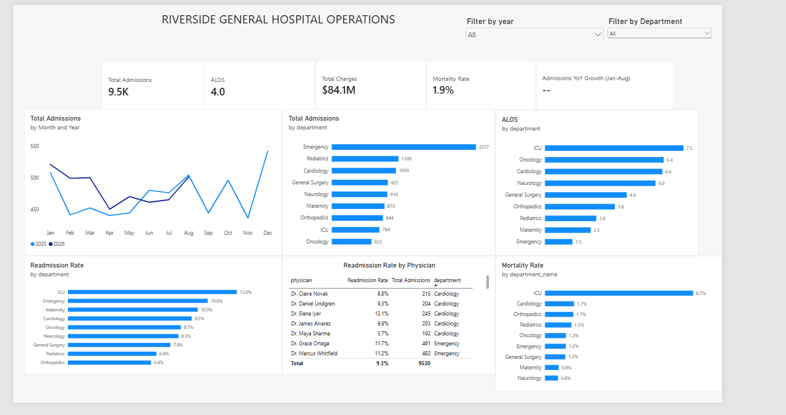
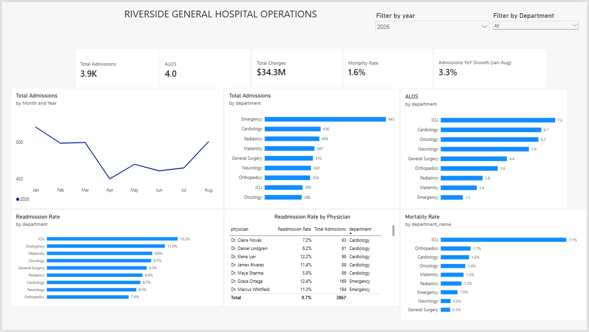
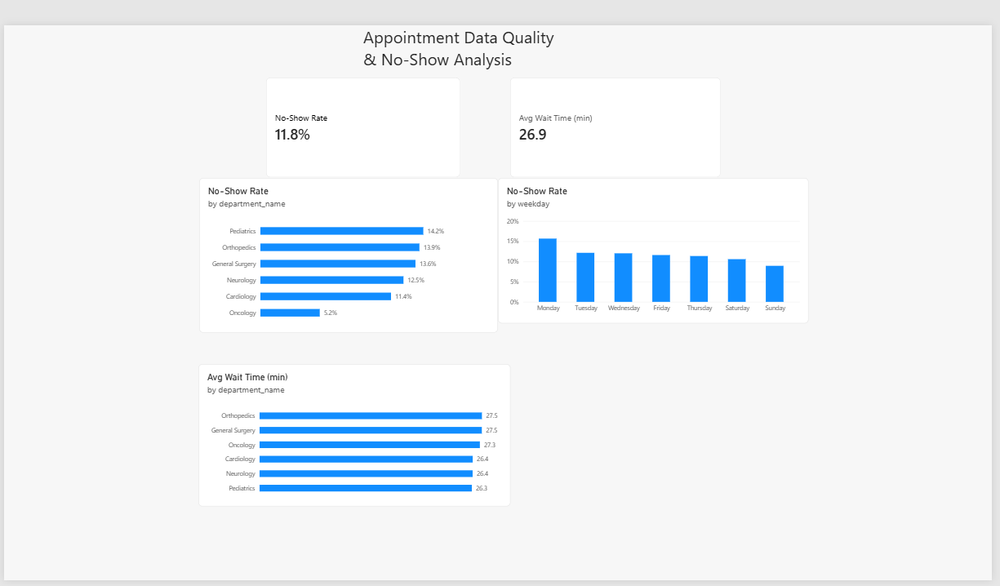
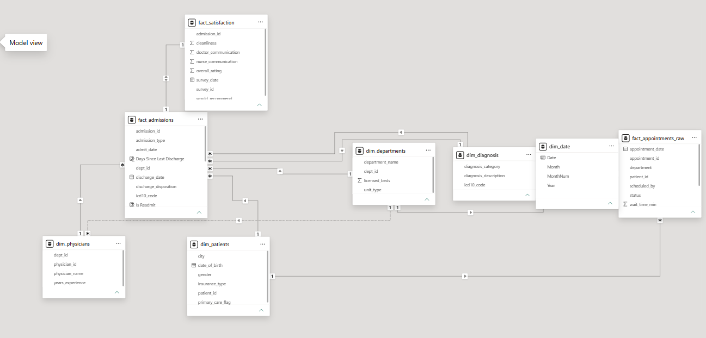

# Healthcare Operations Dashboard (Power BI)

An interactive two-page Power BI report for a hospital, covering admissions, length of stay, readmissions, mortality, and appointment no-shows. Built on a star schema with DAX measures.

*Data is simulated for practice.*

## Dashboard Preview

**Page 1: Hospital Operations (all years)**

**Page 1: filtered to 2026 (shows Jan-Aug year-over-year growth)**

**Page 2: Appointment Data Quality & No-Show Analysis**

**Data model (star schema)**

## Business Questions

- How many patients are admitted, and which departments drive volume?
- Which departments have the longest stays and highest readmission rates?
- Where is mortality concentrated?
- Which days and departments have the most appointment no-shows?

## Key Findings

- **9,530 admissions** across all years, with an average length of stay of **4.0 days**, **$84.1M** in total charges, and **1.9%** mortality.
- **Emergency** has the highest volume (2,377 admissions) but the shortest stay (1.5 days). **ICU** has the longest stay (7.5 days).
- **ICU** has the highest readmission rate (13.0%) against an overall rate of 9.3%, and the highest mortality (about 9%; other departments are 1-2%).
- Admissions are up **3.3%** in Jan-Aug 2026 versus Jan-Aug 2025.
- The overall **no-show rate is 11.8%**. Monday is the worst day (about 16%) and Sunday the best (about 9%).
- No-shows by department range from **14.2% (Pediatrics)** to **5.2% (Oncology)**. Average appointment wait is about 27 minutes in every department.

## Tools and Skills

- **Power BI:** report design, slicers, KPI cards, interactive visuals
- **Data modeling:** star schema with dimension and fact tables
- **DAX:** `CALCULATE`, `DIVIDE`, `SAMEPERIODLASTYEAR`, variables
- **Power Query:** data cleaning, including the raw appointments file

## Files

- `POWER BI ANALYSIS.pbix`: the Power BI report (open in Power BI Desktop)
- `Analysis.pdf`: PDF export of both pages
- `screenshots/`: dashboard and data model images
- `data/`: the source CSV files (dim_departments, dim_diagnosis, dim_patients, dim_physicians, fact_admissions, fact_appointments_raw, fact_satisfaction)
